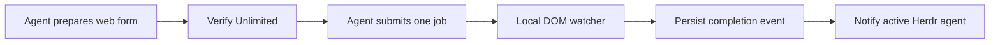

# Higgsfield Unlimited Watch

**Let your AI agent handle your Higgsfield web Unlimited workflow. Let a local watcher do the waiting.**

[](https://github.com/boyjustin76/higgsfield-unlimited-watch/actions/workflows/test.yml)


[](LICENSE)

A self-contained agent skill and dependency-free Python helper for eligible Higgsfield accounts. Check the actual Unlimited toggle and submit label, follow a result by its asset ID, and notify an active Herdr agent when it finishes—without repeated LLM status checks.

**Experimental v0.1.0a2.** Tested browser environment: Windows + WSL Ubuntu + terminal-browser. This project does not grant Unlimited access. Eligibility and limits belong to Higgsfield. [Verified scope and limitations →](docs/validation.md)

## The problem

Your account may have a web Unlimited entitlement that your current generation integration cannot select. An agent can operate the website, but asking it to repeatedly inspect a long-running generation adds model calls and interrupts useful work.

This skill separates the work: the agent prepares and submits an authorized web job; a local process waits; the agent receives a compact event and reviews the result.



## Why this implementation?

- **Checks the actual web controls.** A model badge is not an enabled Unlimited switch. Missing or ambiguous controls stop the helper.
- **Waits locally.** No LLM client or API key in the polling loop. Notification and resumed agent work still use the host's resources.
- **Follows an asset, not a snapshot ref.** Uses `data-asset-id` and `data-job-status`; unknown states remain unknown.
- **Keeps authentication in the browser.** No exported cookies, Clerk tokens, or private generation API calls in this helper.
- **Makes recovery explicit.** Persistent events, exclusive monitor locks and send receipts; no blind generation retry.

Other projects already offer Unlimited APIs, MCP servers, queues and polling. We focus on this visible-web workflow and conservative recovery. [Alternatives and research →](docs/competitors.md)

## Try it without an account

```bash
git clone https://github.com/boyjustin76/higgsfield-unlimited-watch.git
cd higgsfield-unlimited-watch
python skills/higgsfield-unlimited-watch/scripts/huw.py demo
python -m unittest discover -s tests -v
```

The demo is **synthetic**, completes immediately with a virtual clock and never opens a browser or generates media. It exercises the same DOM classifier and event persistence used by the watcher.

## Use your signed-in browser

1. Have Python 3.10+ and a signed-in terminal-browser session ready. [First-time Windows setup →](skills/higgsfield-unlimited-watch/references/setup.md)
2. Copy `config.example.json` to `config.local.json`. Set your binary path and the browser/tab IDs from `terminal-browser ls --all`.
3. Inspect the form:

```bash
python skills/higgsfield-unlimited-watch/scripts/huw.py inspect --config config.local.json
```

4. Ask your agent to use [the skill](skills/higgsfield-unlimited-watch/SKILL.md) for one authorized web job. After identifying the **new result asset UUID**, start:

```bash
python skills/higgsfield-unlimited-watch/scripts/huw.py watch \
  --config config.local.json --asset-id RESULT_UUID --state-dir local/job-001
```

Use a single line in PowerShell. Run the monitor in a background terminal; optional `--hc HC_EXECUTABLE --notify-terminal AGENT_TERMINAL_ID --notify-app copilot` connects an active Herdr session. Select `codex` instead when that is the intended app; both target flags are required. [Herdr setup →](skills/higgsfield-unlimited-watch/references/setup.md#herdr-background-monitor)

The helper **does not click Generate** or enforce an account-wide queue. The skill directs the agent to verify the complete settings, keep one job active and submit once. A UI check is a point-in-time observation, not a billing guarantee.

## Install the skill

Copy the entire `skills/higgsfield-unlimited-watch/` directory into your agent's skill directory—not just `SKILL.md`. For Codex, a typical destination is `~/.codex/skills/higgsfield-unlimited-watch/`; use your host's configured location if different. Alternatively, tell your agent to read the skill directly from this checkout.

No MCP server installation is required for this version. A future MCP wrapper could expose the same browser workflow; MCP itself is not the limitation. Existing service integrations may offer different entitlement paths.

## Commands

| Command | Effect |
|---|---|
| `inspect` | Read compact form state, no page mutation |
| `ensure-unlimited` | Enable the switch if OFF, then verify switch + submit label |
| `set-prompt --file FILE` | Clear, fill and verify the prompt; no submission |
| `watch` | Follow one exact result; write state transitions and final event |
| `relay` | Attempt one Herdr notification for an existing event |
| `demo` | Offline synthetic lifecycle |

## Limits worth knowing

The browser must remain open and show the relevant history card. Site redesigns, virtualized history and navigation can hide the target. Pending/failure enum variants are partly synthetic-test coverage. A fresh full generation lifecycle and second-machine installation remain release-validation tasks. No closed-app wake or exactly-once remote delivery is promised.

See [recovery](skills/higgsfield-unlimited-watch/references/recovery.md), [validation](docs/validation.md), [product decisions](docs/strategy.md), and [contributing](CONTRIBUTING.md).

## Credits

Built on [terminal-browser](https://github.com/zenbu-labs/terminal-browser). Herdr integration uses the installed herdr-core `hc` command. Independent community project; not affiliated with Higgsfield. Original implementation, licensed under [MIT](LICENSE).
# Rust implementation (local migration candidate)

See [RUST_PORT.md](RUST_PORT.md) for the five checkpoints, compatibility matrix,
commands and verification limitations. Build with `cargo build --release`;
the binary is `target/release/huw` (`huw.exe` on Windows). Existing Python
entry points remain unchanged; no automatic installer switch is performed.
